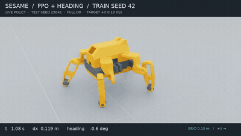
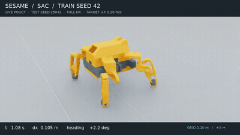
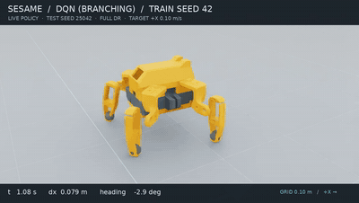
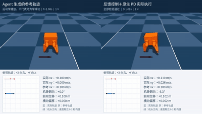
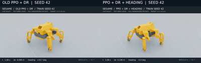
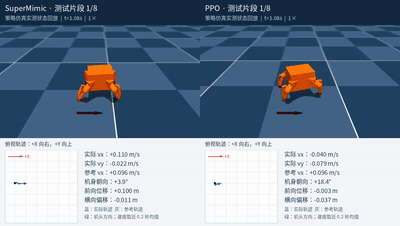
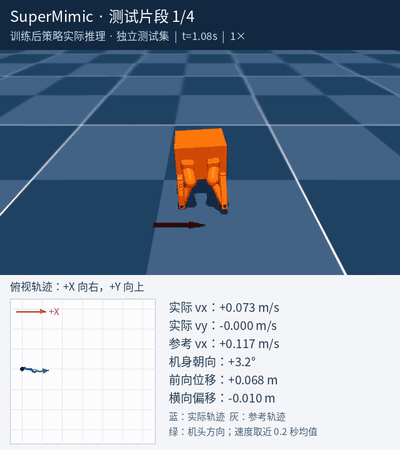

# 上海交通大学强化学习课程作业

Sesame 是一台具有 8 个主动关节的小型四足机器人。本项目在 Isaac 中比较平地直行策略，在 MuJoCo 中研究参考轨迹生成与跟踪。[实验报告（PDF）](reports/course_rerun_20261116/report.pdf) · [训练、评估与模型权重](docs/COURSE_RUN.md) · [项目介绍](INTRODUCTION.md) · [报告 LaTeX 源码包](reports/course_rerun_20261116/sesame_report_latex.zip)

## 平地行走基线

三种策略跟踪同一条沿世界 +X 方向、速度为 0.10 m/s 的指令。下列视频使用相同的仿真初态和物理参数，训练种子为 42，测试种子为 25042。动图展示片段，点击可打开完整 MP4。

| 方法 | 控制方式 | 策略推理视频 |
| --- | --- | --- |
| **PPO** | 根据当前策略采集的交互数据更新策略，连续输出 8 个关节的位置偏移。 |  [完整视频 · 10 秒](runs/offpolicy_heading_20261107/videos/ppo_seed42/offpolicy_ppo_seed42_seed25042.mp4) |
| **SAC** | 从经验回放中采样，结合回报与策略熵学习连续关节动作。 |  [完整视频 · 10 秒](runs/offpolicy_heading_20261107/videos/sac_seed42/offpolicy_sac_seed42_seed25042.mp4) |
| **DQN** | 采用分支 Double DQN，每个关节从 5 档离散位置偏移中选择动作。 |  [完整视频 · 10 秒](runs/offpolicy_heading_20261107/videos/dqn_seed42/offpolicy_dqn_seed42_seed25042.mp4) |

## 参考轨迹生成与奖励设计

| 实验 | 视频内容 | 仿真演示 |
| --- | --- | --- |
| **Codex 参考轨迹与控制器检验** | 左侧为 Codex 生成的运动学参考，右侧为反馈与 PD 控制器的物理仿真执行。6 秒内参考前进 0.600 m，执行前进 0.585 m，对应报告图 6。 |  [完整视频 · 6 秒](runs/agent32_collection_20261114/reference_vs_execution.mp4) |
| **PPO 航向奖励对照** | 并排展示加入绝对航向奖励前后两组策略的行走方向，用于观察机器人直行时的偏航。 |  [完整视频 · 10 秒](runs/ppo_heading_20261105/comparison_videos/ppo_heading_comparison_seed15042.mp4) |

## SuperMimic 早期实验录像

以下两段录像保留了早期权重的推理表现。最终报告第 5 节的四组对照采用 2,097,152 个真实环境步预算，结果见报告第 5.5 节。

| 实验 | 权重与测试条件 | 策略推理视频 |
| --- | --- | --- |
| **PPO 与 SuperMimic 对照** | 使用 2026 年 11 月 13 日实验的两组最终权重，对比它们在 8 条测试轨迹上的运动。 |  [完整视频 · 72 秒](runs/evaluation_videos_20261114/videos/policy_comparison_all8.mp4) |
| **使用 Agent 参考的 SuperMimic** | 使用 11 月 14 日训练的 `best.pt`（1,048,576 步），在移除足端误差与关节限位奖励项后复测，展示 4 条轨迹。 |  [完整视频 · 24 秒](runs/supermimic_agent32_seed42_20261114/evaluation_no_foot_no_limit_20261115/best_policy_all4.mp4) |
