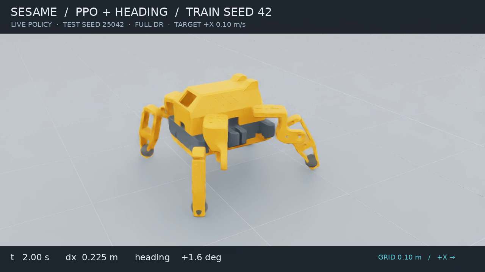
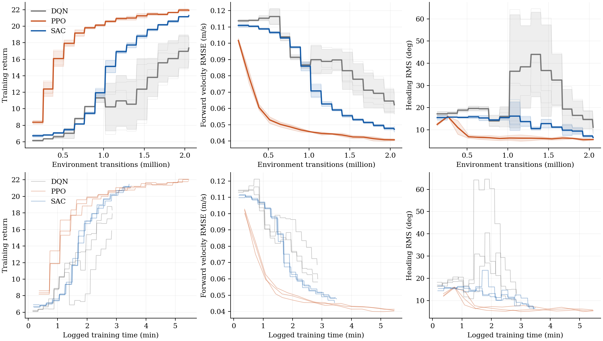
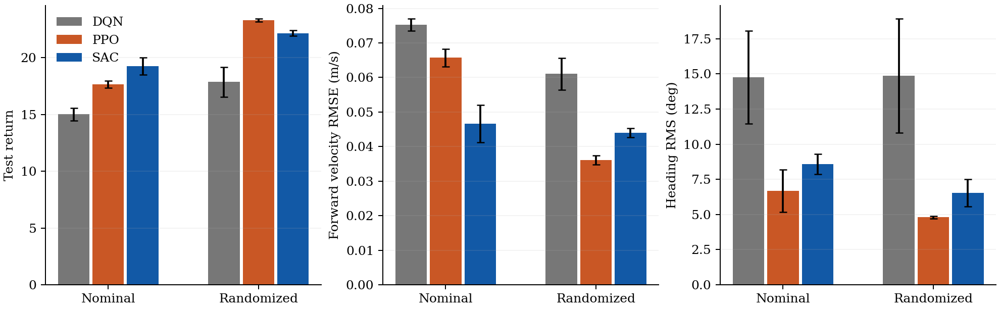
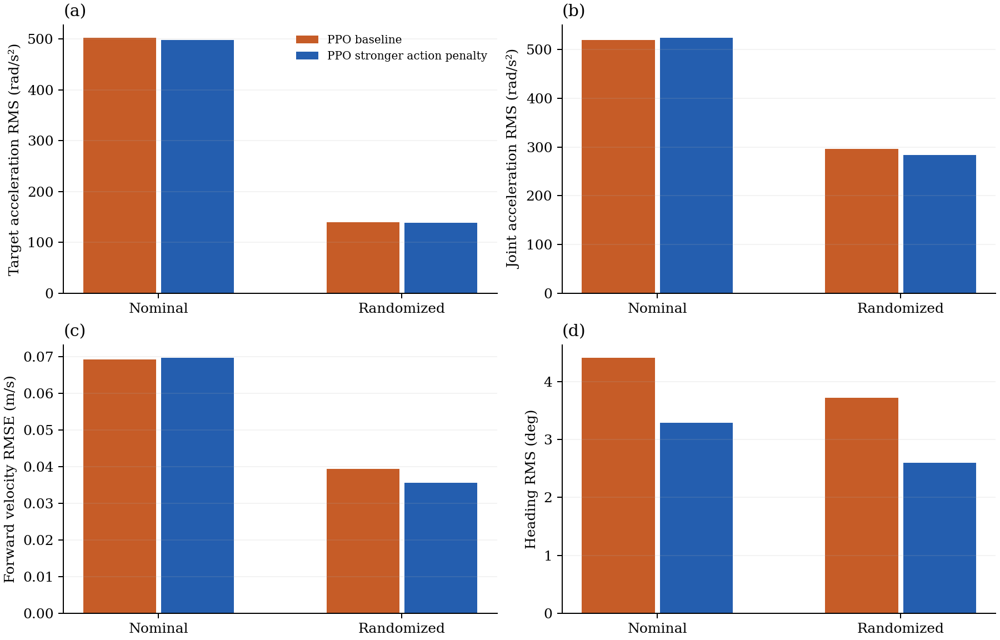
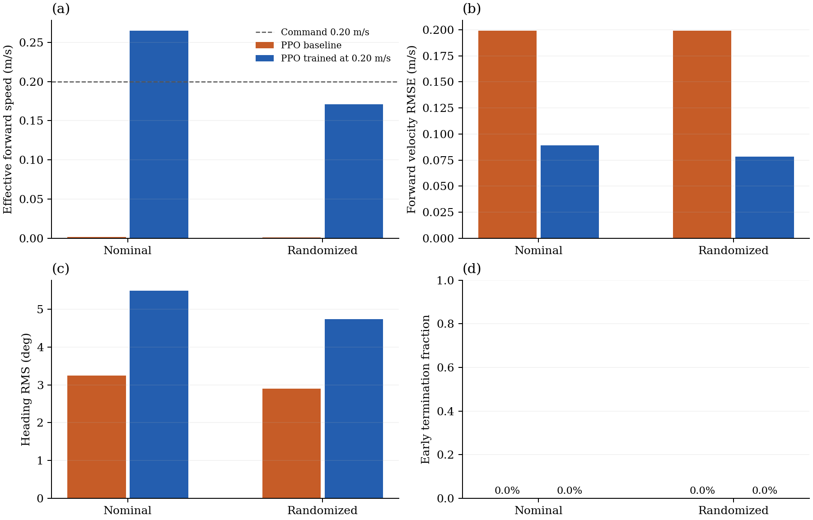

# Sesame 四足机器人行走控制的强化学习实验研究

上海交通大学强化学习课程作业 · 2026年11月

**摘要**：本文以 Sesame 小型四足机器人为对象，研究强化学习行走控制中的速度跟踪、动作平滑性与训练效率。在 Isaac 平地行走任务中比较 DQN、PPO 和 SAC，并通过动作差惩罚与目标速度对照分析运动表现；在 MuJoCo 参考轨迹跟踪任务中比较 PPO、基于官方代码适配的 SuperMimic，以及使用 DeepSeek 和 Codex 生成参考轨迹的 SuperMimic。实验结果表明，PPO 在域随机化评估下取得最高的基线回报，增大动作差惩罚系数降低了动作信号变化率，但实际关节加速度的改善依赖评估条件。SuperMimic 在相同真实交互步数下取得更高的参考跟踪回报，其固定交互预算下的训练耗时高于 PPO。进一步的时间预算对照表明，在包含启动开销的约 8.2 分钟训练时间下，官方代码 SuperMimic 的验证回报较 PPO 高 4.432。

DQN、PPO 和 SAC 基线分别采用 3 个训练随机种子，其余对照实验采用训练种子 42。本文使用任务回报和运动误差评价策略；算法比较限定于相同任务、奖励和测试协议。课程统一评分与实机性能不属于本文评价范围。

## 1. 仿真模型与实验环境

研究对象为 Sesame 小型四足机器人，包含 8 个主动关节和浮动机身，总质量为 0.384 kg。URDF、11 个视觉网格及惯性参数来自公开的 [sesame-ml 模型](https://github.com/lukehollis/sesame-ml)，版本固定为 `a3910f67`。实验以该模型的标称参数作为域随机化的基准，评价范围限定于仿真环境。

模型导入依次执行 URDF 与网格一致性检查、Isaac URDF 转换、USD 关节与质量核对以及 CUDA 仿真验证。为满足 USD 命名约束，派生文件中的网格名以下划线替换连字符，源 URDF 与网格内容保持一致。导入模型包含 8 个转动关节和 9 个具有质量的刚体，其总质量与源模型一致。

图 1：Sesame 在 Isaac 平地环境中执行 PPO 行走策略。图像截取自策略仿真轨迹第 2 秒。

| 设置 | 实验配置 |
|---|---|
| GPU | NVIDIA RTX 4090 D，24 GB 显存 |
| 基线仿真环境 | Isaac Sim 4.5、Isaac Lab 2.3、PyTorch 2.7、CUDA 12.8 |
| 地形与指令 | 水平地面，沿世界 +X 方向以 0.10 m/s 前进 |
| 控制频率 | 50 Hz；物理步长 2 ms，每 10 个物理步更新动作 |
| 观测与动作 | 36 维观测，8 维关节位置偏移动作 |
| 并行规模 | 256 个环境，每回合最多 10 秒 |
| 随机化 | 质量、接触摩擦、PD 参数、电机能力、控制时延/滞后和初始状态 |

速度指令行走实验采用 Isaac 环境，参考轨迹跟踪实验采用 mjlab / MuJoCo GPU 环境。两类任务具有不同的奖励、观测与目标定义，回报仅在各自任务的统一设置内比较。

## 2. DQN、PPO 与 SAC 基线比较

DQN、PPO 和 SAC 使用相同的行走奖励、域随机化范围与终止规则。每种算法分别使用训练种子 42、43、44，每个种子的交互预算为 204.8 万步。PPO 和 SAC 输出 8 维连续动作；DQN 采用分支网络与 Double DQN 更新，将每个关节离散为 5 档，输出 40 个 Q 值。比较在相同任务和交互预算下进行，各算法保留其动作表示、网络、观测归一化与优化配置。

### 2.1 固定参数评估与域随机化评估

Isaac 行走实验采用两种测试环境：固定参数评估（Nominal）和域随机化评估（Domain randomization），表中分别记为“固定参数”和“域随机化”。所有策略均在下述域随机化范围内训练；每个模型使用同一组冻结权重分别进行两种评估。该设计比较环境参数变化下的策略表现，不涉及训练阶段域随机化开关的消融。

**固定参数评估**：质量、惯量、PD 增益和电机力矩/速度上限固定为模型及仿真配置的标称值，接触摩擦系数为 0.9，额外动作通信延迟与一阶滞后关闭。初始偏航角和平面速度为 0；初始关节角叠加均匀分布的 ±0.015 rad 扰动。

**域随机化评估**：每个并行环境在回合重置时独立采样参数，并在回合内固定。全身质量和惯量使用同一个 0.8–1.2 倍缩放系数；PD 比例增益与微分增益分别缩放至标称值的 0.8–1.2 倍；电机力矩与速度上限缩放至 0.8–1.0 倍。机器人摩擦系数从 0.3–1.5 的 64 档中采样，地面摩擦固定为 0.9。采用平均摩擦组合规则后，有效接触摩擦范围为 0.6–1.2。

动作通信延迟取 0、20 或 40 ms，一阶动作滞后的时间常数为 20–60 ms。初始关节角扰动范围为 ±0.035 rad，偏航角范围为 ±5°，X、Y 方向初速度分别在 ±0.02 m/s 内采样。连续变量服从均匀分布。两种评估均关闭额外观测噪声并采用平地；同一对照内的目标速度、奖励和终止规则一致。图中 Fixed parameters 与 Domain randomization 对应上述两种条件。

该评估协议适用于第 2、4、5 节的 Isaac 实验。两种条件在动力学、执行器响应与初态分布上存在差异，其回报差异描述同一策略对测试分布的响应。训练阶段域随机化的因果效应需要独立的开关消融；MuJoCo 参考跟踪任务采用第 6 节的独立配置。

### 2.2 训练曲线与共同测试结果

所有学习曲线以各次运行首次记录到有效参数更新的日志时刻为启动阶段终点，仅绘制该时刻及之后的记录。该边界由日志记录频率确定，不等同于精确的首个优化器步结束时刻。时间横轴减去该时刻的累计训练用时，表示首次更新后训练时间；步数横轴保留原始真实交互步数。EMA 在完整记录上计算后裁剪，曲线从保留范围内的首条实测记录开始，不补造零时刻数据。

图 2：三种基线的训练曲线。上、下排横轴分别为绝对真实环境步数和扣除启动阶段后的训练时间，纵轴依次为训练回报、前向速度 RMSE 与航向 RMS。每个种子以首次记录到参数更新完成的日志时刻为时间零点，仅绘制此后的已有记录，不补造零点回报。SAC/DQN 采用首次 optimizer_updates 非零的周期日志，其时刻不等同于精确的第一次优化完成时刻。因果 EMA 在完整记录上计算，半衰期为 131,072 步，再裁剪显示区间；三个训练种子在共同保留步数处计算均值与样本标准差，下排横轴取各自扣除启动时间后的均值。连续实线连接已有 EMA 值。PPO 误差指标共 16 个诊断时刻；回报窗口为 PPO 最近 100 回合、SAC/DQN 最近 256 回合。最终测试统计不作平滑。

最终模型分别在固定参数与域随机化条件下测试。每个模型在每种条件下评估 128 个完整首回合，每种算法每种条件合计 384 回合，总计 2304 回合。同条件下，各算法使用配对的初态与物理参数。结果以三个训练种子的均值 ± 样本标准差表示。

| 条件 | 方法 | 测试回报 | 前向速度 RMSE（m/s） | 航向 RMS（°） |
|---|---|---:|---:|---:|
| 固定参数 | DQN | 15.00 ± 0.55 | 0.0753 ± 0.0017 | 14.76 ± 3.31 |
| 固定参数 | PPO | 17.65 ± 0.32 | 0.0657 ± 0.0026 | 6.68 ± 1.50 |
| 固定参数 | SAC | 19.24 ± 0.77 | 0.0466 ± 0.0054 | 8.58 ± 0.70 |
| 域随机化 | DQN | 17.85 ± 1.33 | 0.0610 ± 0.0046 | 14.87 ± 4.06 |
| 域随机化 | PPO | 23.30 ± 0.13 | 0.0361 ± 0.0013 | 4.80 ± 0.09 |
| 域随机化 | SAC | 22.15 ± 0.26 | 0.0440 ± 0.0014 | 6.55 ± 0.97 |

图 3：三种基线的共同测试结果。固定参数与域随机化评估设置见第 2.1 节，训练均采用域随机化。连续实线连接两种评估条件下三个训练种子的测试均值，阴影表示样本标准差；每种方法、每种条件共 384 回合。横轴为分类条件，连线用于比较。数值为未经平滑的原始测试统计。

固定参数评估下，SAC 的前向速度 RMSE 最低，为 0.0466 m/s；域随机化评估下，PPO 获得最高回报 23.30，并取得最低的速度 RMSE 0.0361 m/s 和航向 RMS 4.80°。DQN 的速度和航向误差高于两种连续动作方法。三种方法在全部测试回合中均记录到零跌倒，因此该样本内的跌倒率未形成方法间差异。

| 方法 | 训练阶段（分钟） | 训练进程总时间（分钟） |
|---|---:|---:|
| DQN | 2.85 ± 0.01 | 2.92 ± 0.01 |
| PPO | 5.45 ± 0.01 | 5.58 ± 0.03 |
| SAC | 3.46 ± 0.04 | 3.54 ± 0.04 |

PPO 的训练时间为采样与更新耗时之和，SAC/DQN 的训练时间为训练循环墙钟时间；进程总时间包括初始化与最终保存。各运行的 GPU 外部负载、优化次数及诊断开销未作严格配平，该计时结果描述各实现包含启动阶段的实测开销，与扣除启动阶段的曲线时间坐标分别报告。

评价指标定义为：回报 `Σr_t`；前向速度误差 `√mean((v_x−0.10)²)`；航向误差 `√mean(wrap(ψ−ψ_cmd)²)`。速度采用世界坐标系，航向误差以度表示。机身高度低于 0.023 m 或倾斜超过约 60°时判定为跌倒；越界与非有限状态单独统计。

## 3. 行走奖励函数设计

行走奖励由目标跟踪、姿态稳定、动作平滑和力矩正则项组成。[宇树 Go2 官方奖励配置](https://github.com/unitreerobotics/unitree_rl_lab/blob/main/source/unitree_rl_lab/unitree_rl_lab/tasks/locomotion/robots/go2/velocity_env_cfg.py)提供了速度跟踪、姿态、关节运动、功率与接触行为等设计要素。Sesame 的奖励权重依据其质量、关节数量和动作尺度设定。

DQN、PPO 和 SAC 共用以下行走奖励。`v` 表示世界系线速度，`ω` 表示机身系角速度，`u` 为截断到 `[0,1]` 的直立程度，`a` 为归一化动作；`mean` 表示对 8 个关节取平均。

| 类别 | 奖励率 | 作用 |
|---|---|---|
| 速度跟踪 | `1.5 exp(−((vx−0.1)²+vy²)/0.01)u²` | 接近目标速度并限制横向运动；倾倒时削弱奖励 |
| 前向运动 | `clip(vx/0.1,−1,1)u²` | 提供持续前向运动激励 |
| 航向保持 | `−0.5(1−cos(ψ−ψ_cmd))` | 约束机身朝向与世界 +X 轴一致； `ψ_cmd=0` |
| 直立 | `+0.35u` | 鼓励保持机身直立 |
| 横向速度 | `−0.10(vy/0.10)²` | 减少侧向漂移 |
| 偏航角速度 | `−0.03ωz²` | 约束瞬时偏航角速度 |
| 横滚/俯仰角速度 | `−0.01(ωx²+ωy²)` | 减少机身快速摇摆 |
| 垂直速度 | `−0.02(vz/0.10)²` | 减少上下跳动 |
| 力矩 | `−0.02 mean((τ/0.18)²)` | 对关节力矩实施平方正则化 |
| 相邻动作差 | `−0.08 mean((a_t−a_(t−1))²)` | 约束相邻控制信号变化 |
| 站姿偏离 | `−0.10 mean((q−q_stand)²)` | 抑制过大姿态偏离，保留正常步态空间 |

单步奖励为 `r_t = 0.02 × 奖励率总和 − 2 × I(真正终止)`。跌倒、越界或无效状态触发一次终止惩罚，正常超时不计该项。奖励项的作用由系数、变量尺度、聚合方式和时间积分共同决定。例如，垂直速度项等价于 `−2vz²`，再乘以 0.02 s 控制步长。

该基线在速度与姿态奖励上设置绝对航向约束，不包含关节速度/加速度、机械功率、腾空时间、接触时间方差、滑脚、异常接触和软限位项。第 6 节的参考跟踪任务采用独立奖励，其足端跟踪和关节限位惩罚权重为零。

## 4. 动作平滑性实验

为评估动作差惩罚对控制平滑性的影响，分别训练系数为 0.08 与 0.16 的 PPO 策略。两组目标速度均为 0.10 m/s，初始网络参数、环境状态与域参数一致，训练种子为 42，交互预算为 204.8 万步。动作信号变化与实际关节加速度分别作为控制层和运动层的平滑性指标。

测试采用第 2.1 节的两种评估条件。两组统一使用动作差系数 0.08 计算测试回报，并记录各自训练奖励下的回报。每个模型每种条件采用测试种子 35042、36042，共评估 128 回合。实验使用一个训练种子。

图 4：动作差惩罚加倍与原设置 PPO 的平滑性对照。(a) 执行目标角加速度 RMS；(b) 实际关节加速度 RMS；(c) 前向速度 RMSE；(d) 航向 RMS。固定参数与域随机化评估设置见第 2.1 节。连续实线连接两种评估条件下单个训练种子、128 回合的原始测试均值，无跨种子误差带。横轴为分类条件，连线用于比较；平滑性结合速度误差评估。

| 条件 | 方法 | 共同奖励回报 | 目标加速度 RMS（rad/s²） | 实际关节加速度 RMS（rad/s²） | 前进速度（m/s） | 速度 RMSE（m/s） | 航向 RMS（°） | 跌倒数 / 回合数 |
|---|---|---:|---:|---:|---:|---:|---:|---:|
| 固定参数 | 基线 | 17.606 | 503.25 | 519.11 | 0.1249 | 0.0692 | 4.41 | 0/128 |
| 域随机化 | 基线 | 22.770 | 140.08 | 296.30 | 0.1232 | 0.0394 | 3.72 | 0/128 |
| 固定参数 | 动作差惩罚加倍 | 17.863 | 498.43 | 524.62 | 0.1387 | 0.0697 | 3.28 | 0/128 |
| 域随机化 | 动作差惩罚加倍 | 23.162 | 138.56 | 283.62 | 0.1146 | 0.0356 | 2.60 | 0/128 |

动作差惩罚系数加倍后，固定参数与域随机化条件下的归一化动作变化率分别下降 3.85% 和 6.08%。实际关节加速度在域随机化条件下下降 4.28%，在固定参数条件下增加 1.06%。域随机化条件下，有效前进速度由 0.1232 降至 0.1146 m/s，更接近 0.10 m/s 指令，速度与航向误差同步减小；固定参数条件下，速度升至 0.1387 m/s，超速幅度增加。结果表明，动作差正则化降低了控制信号变化，但其对实际关节运动的影响具有条件依赖性。进一步研究方向为实际关节加速度和机械功率正则化，其效果需通过独立对照实验评估。

归一化动作变化率定义为相邻动作差的 RMS 除以 0.02 s，单位为归一化动作每秒。实际关节加速度由 50 Hz 关节速度差分 Δq̇ / 0.02 秒计算，单位为 rad/s²；执行目标角加速度采用相同控制周期差分。统计排除回合重置跳变，首步速度差分使用已知重置速度。该指标描述控制频率下的加速度 RMS，不表示 500 Hz 物理子步的加速度峰值。平滑性结果与前进速度、航向误差和跌倒数联合评价，以区分稳定行走与低运动幅度造成的低加速度。

## 5. 高速行走实验

为评估较高速度指令下的行走性能，将训练目标速度由 0.10 提高至 0.20 m/s。奖励形式、动作差系数 0.08、域随机化范围和训练预算保持一致。测试中，两组均接收 0.20 m/s 指令：一组为在该速度下训练的 PPO，另一组为 0.10 m/s 策略直接迁移。实验范围为上述两个速度设置。

图 5：0.20 m/s 指令下高速训练与低速策略直接迁移的对照。(a) 有效前进速度，灰色实线为目标；(b) 速度 RMSE；(c) 航向 RMS；(d) 提前终止比例，包括跌倒、越界和无效状态。固定参数与域随机化评估设置见第 2.1 节。连续实线连接两种评估条件下单个训练种子、128 回合的原始测试均值，无跨种子误差带。横轴为分类条件，连线用于比较；提前终止比例均为零，两组曲线重合。

| 条件 | 方法 | 共同奖励回报 | 前进速度（m/s） | 速度 RMSE（m/s） | 航向 RMS（°） | 侧移（cm） | 跌倒数 / 回合数 | 提前终止数 / 回合数 |
|---|---|---:|---:|---:|---:|---:|---:|---:|
| 固定参数 | 低速策略直接迁移 | 3.620 | 0.0019 | 0.1992 | 3.24 | 1.64 | 0/128 | 0/128 |
| 域随机化 | 低速策略直接迁移 | 3.657 | 0.0014 | 0.1992 | 2.90 | 1.74 | 0/128 | 0/128 |
| 固定参数 | 0.20 m/s 训练 | 15.521 | 0.2651 | 0.0889 | 5.49 | 7.96 | 0/128 | 0/128 |
| 域随机化 | 0.20 m/s 训练 | 17.108 | 0.1708 | 0.0782 | 4.74 | 15.40 | 0/128 | 0/128 |

低速策略直接接收 0.20 m/s 指令时，固定参数与域随机化条件下的速度分别为 0.0019 和 0.0014 m/s，表现为近静止。在 0.20 m/s 下训练的策略分别达到 0.2651 和 0.1708 m/s，相对指令超出 32.6% 和低于 14.6%。高速策略的 256 个测试回合均完整执行，航向 RMS 分别为 5.49° 和 4.74°。该策略实现了较快前进，仍存在速度偏差和侧向漂移。速度指令范围训练与逐级提高速度上限是针对上述误差的研究方向，未纳入本文对照。

高速策略在固定参数条件下的净位移速度与 50 Hz 速度采样均值分别为 0.2651 和 0.2637 m/s；域随机化条件下分别为 0.1708 和 0.1610 m/s。两种统计量分别反映回合净位移和离散采样速度，其差异在域随机化条件下更大。现有记录未分离接触运动与采样时刻对该差异的贡献。

有效前进速度定义为世界 X 方向净位移除以回合时长。提前终止包括跌倒、越界与非有限状态，正常 10 s 超时作为完整回合。全部测试轨迹均纳入统计。

三组策略的[训练曲线](improvements/motion_training_curves.pdf)分别采用各自训练奖励。由于动作差系数或速度目标不同，训练回报用于描述各组优化过程；组间性能比较采用共同测试奖励。

| 训练设置 | 采样与更新时间（分钟） | 程序启动至训练结束（分钟，关闭前） |
|---|---:|---:|
| 原设置 PPO | 2.40 | 2.49 |
| 动作差惩罚加倍 | 2.40 | 2.49 |
| 0.20 m/s 训练 | 2.42 | 2.51 |

三组训练串行执行。训练计时覆盖采样与参数更新，程序计时覆盖启动至结果保存、仿真关闭之前的区间，独立评估时间不计入其中。第 2 节基线实验与本节实验的运行负载和计时环境不同，时间比较分别在各实验组内进行。

评估使用各组训练预算结束时的模型，共计 1024 个测试回合。该实验采用单个训练种子，结果描述固定初始化与训练预算下的策略差异。

## 6. 基于世界模型的策略学习与参考轨迹对照

### 6.1 方法与实现

PPO 通过物理仿真交互采集状态转移并更新策略。SuperMimic 交替执行仿真采样、世界模型学习和策略优化：世界模型预测状态变化，策略通过短期想象轨迹的时间反向传播优化回报，Critic 估计想象窗口之后的价值。世界模型在单次策略更新期间冻结，并在后续模型更新中继续学习。该方法通过可微动力学预测复用不同参考动作共享的状态转移规律，以降低策略优化对物理仿真采样的需求。[SuperMimic 项目说明](https://supermimic.github.io/)

SuperMimic 论文区分了 PPO-Sim 与 PPO-WM：前者在物理仿真中采样，后者在学习得到的世界模型中采样；SuperMimic 则直接对想象回报求梯度。论文中超过 1000 倍的 GPU 小时差距对应与 SONIC 的比较，PPO-WM 实验比较的是达到目标训练回报所需的想象步数，二者均不等价于本实验相对 PPO 的实测训练加速比。[SuperMimic 论文，第 4.1–4.2 节](https://arxiv.org/pdf/2610.28480)

实验基于作者开源实现，固定 SuperMimic 提交 `5efbf114e11f725c31d83e217be987c13c0e4ce2` 和 mjlab_research 提交 `dd51a9fcc98791a2f0b018b3c7f71a3eefd5ecdd`。在保留官方优化器、可微世界模型及策略学习流程的基础上，将面向 G1 人形机器人的配置适配为 Sesame，调整机器人模型、动作维数、参考数据、网络规模和任务奖励。因此，该实现属于官方代码的 Sesame 任务适配，实验范围不涵盖原论文全部设置。[官方 SuperMimic 仓库](https://github.com/HybridRobotics/supermimic)；[官方 mjlab_research 仓库](https://github.com/HybridRobotics/mjlab_research)

PPO 对照采用 `rsl_rl` 优化器，与 SuperMimic 使用相同的 Actor/Critic 结构，并在物理仿真中采样，属于 PPO-Sim。官方文件 `supermimic/runners/ppo_runner.py` 通过 `wm_env` 和 `imagine()` 执行 PPO-WM；PPO-WM 不属于本实验的对照组。PPO 超参数保持固定，未进行搜索。

图 6：参考动作提供任务目标；世界模型通过策略采集的物理仿真状态转移学习。

### 6.2 参考轨迹来源与对照组

| 方法 | 策略训练方法 | 训练参考来源 | 对照目的 |
|---|---|---|---|
| PPO | 物理仿真中的 PPO | 原始参考 | 无世界模型的基线 |
| SuperMimic（官方代码） | 官方 SuperMimic 的 Sesame 适配 | 与 PPO 相同的原始参考 | 更换策略训练方法的影响 |
| SuperMimic（DeepSeek） | 同一 SuperMimic 实现 | `deepseek-flash` 生成程序，经检查和仿真验证后的参考 | DeepSeek 数据生成流程与训练组合的效果 |
| SuperMimic（Codex） | 同一 SuperMimic 实现 | 对话 Agent 编写程序，经检查和仿真验证后的参考 | Codex 数据生成流程与训练组合的效果 |

原始参考由 Isaac 教师策略采集；DeepSeek 与 Codex 参考由 mjlab / MuJoCo 中的控制器实际执行获得。因此，参考来源的变化同时涉及动作分布及其与训练仿真动力学的一致性，该对照评估数据生成与策略训练的整体效果，不能单独归因于语言模型能力。两种 Agent 共享解析反馈控制、物理检查和工程先验；Codex 程序包含历史调试经验，DeepSeek 提示包含可执行范例。

Agent 生成参考轨迹作为跟踪目标，推理阶段由训练后的策略输出 8 维动作。世界模型通过策略在线采集的状态转移学习，32 条参考轨迹并不限定世界模型的转移样本数。

参考生成采用 MimicAgent 的“动作规划 → 程序生成 → 执行检查 → 诊断修订”流程。MimicAgent 原论文通过运动学检查筛选粗参考，再由强化学习获得动力学可行的执行。本实验在运动学检查之外增加标称参数及域随机化条件下的物理仿真验收，入库数据为通过检查的实际执行轨迹。MimicAgent 负责参考生成，SuperMimic 负责策略训练。[MimicAgent 论文，第 III 节](https://arxiv.org/html/2609.24145v1#S3)

### 6.3 实验设置与评价指标

四组采用相同的机器人、地形、跟踪奖励、0.5 ms 物理步长、50 Hz 控制频率、512 个并行环境、Actor/Critic 结构、域随机化配置及 2,097,152 个真实环境步预算。训练参考均为 24 条，每条 6 秒，参考来源为预设实验变量。原始参考截取前 6 秒；Codex 数据按统一验收规则获得 41 条合格记录，取固定顺序前 32 条，再固定打乱为 24/4/4 的训练、验证和测试划分；DeepSeek 的 32 条参考采用相同划分。Codex 数据划分独立于历史 32 条参考实验的划分。验证集与测试集各包含原始、DeepSeek、Codex 三个来源的 4 条轨迹，共 12 条，各来源等权。测试轨迹不参与任何组的训练或生成提示。

学习曲线纵轴为验证轨迹回报 `Return = Σr_t`，横轴为首次更新后训练时间。各组以首次有效更新日志对应的累计训练时间为原点，剔除该时刻之前的评估记录；首条保留评估的横坐标由原始时间差确定，不额外平移至零。EMA 在完整评估记录上计算后裁剪。验证从参考轨迹第一帧开始，执行完整 6 秒；最终测试统一采用 `final.pt`。6 秒正奖励上限为 30，对应归一化回报 `Return/30`。

表中训练时间包括仿真采样、模型与策略更新及编译，不含初始化、验证和测试。该统计保留首次更新之前的累计用时，区别于学习曲线扣除启动阶段后的时间坐标。端到端运行时间与参考数据准备成本分别统计。各组在同一 GPU 上串行运行，每次训练使用独立的 Inductor/Triton 编译缓存，并保存 GPU 占用快照。

本节误差均相对参考轨迹计算：平面速度 RMSE 为 `√mean_t((vx−vx_ref)²+(vy−vy_ref)²)`；偏航 RMS 为 `√mean_t(wrap(ψ−ψ_ref)²)`，单位为度；机身位置 RMSE 为 `√mean_t((x−x_ref)²+(y−y_ref)²+(z−z_ref)²)`。先计算每条测试轨迹的 RMSE，再对全部轨迹取平均。第 2 节的速度误差仅采用 `vx−0.10`，航向以世界 +X 方向为基准，两节指标定义不同，不直接比较数值。

RMSE 仅使用提前终止前的有效状态，并同时报告提前终止数。所有组均使用训练种子 42；逐回合离散程度不构成跨训练种子的稳定性证据。固定超参数、单种子和有限训练预算限定了实验结论的适用范围。

### 6.4 跟踪奖励与网络参数

跟踪奖励版本为 `sesame_nonfoot_no_joint_limit_20261115`。各跟踪项采用 `w × exp(−误差平方/尺度²)`，身体跟踪项在所选非足端连杆上取平均。每步奖励等于总奖励率乘以控制周期 0.02 秒。该奖励与第 2 节 Isaac 速度行走任务的奖励不同，在本节四个主对照组及消融组之间保持一致。

| 奖励项 | 权重 w | 尺度 | 作用 |
|---|---:|---:|---|
| 机身位置跟踪 | 0.5 | 0.3 m | 跟踪参考的整体位移 |
| 机身姿态跟踪 | 0.5 | 0.4 rad | 保持参考方向与姿态 |
| 非足端连杆位置 | 1.0 | 0.3 m | 学习身体与腿部协调 |
| 非足端连杆姿态 | 1.0 | 0.4 rad | 限制错误的肢体构型 |
| 非足端连杆线速度 | 1.0 | 1.0 m/s | 跟踪运动速度 |
| 非足端连杆角速度 | 1.0 | 3.14 rad/s | 跟踪转动速度 |
| 相邻动作差平方和 | −0.1 | — | 减少动作跳变 |

Actor 输入由 30 维本体观测的 10 帧历史和 220 维参考目标组成，共 520 维，输出 8 维动作。默认想象长度 H=32；世界模型结构为 512×3，Actor 为 512/256/128，Critic 为 256/128。策略想象批量为 2048；世界模型批量为 512，每次更新使用 10 批数据和 8 步预测训练，replay ratio=16。所有组，包括无 Critic 组，均采用 gamma=0.99。奖励不包含足端跟踪项和关节限位惩罚，物理仿真与想象轨迹采用一致的奖励定义。

PPO 每个环境采样 32 步，每次更新包含 5 个 epochs 和 4 个 minibatches，学习率为 0.001，clip=0.2，gamma=0.99，GAE λ=0.95，熵系数为 0.005，目标 KL=0.01。初始动作标准差固定为 0.1；该探索参数未经过超参数搜索。

### 6.5 主对照结果

图 7：四种方法在共同验证集上的回报与运动误差。横轴为首次有效更新日志之后的训练时间（分钟），各组分别扣除自身启动时段，仅显示该边界之后的实测评估。连续实线连接因果 EMA 值，半衰期为 131072 个真实交互步；EMA 在完整记录上计算后裁剪，不补造零时刻回报。各组采用单个训练种子（seed 42），无跨种子误差带。回报采用原始量纲 Return，6 秒正奖励上限为 30。

| 方法 | 测试 Return | 速度 RMSE（m/s） | 偏航 RMS（°） | 机身 RMSE（cm） |
| --- | ---: | ---: | ---: | ---: |
| PPO | 14.558 | 0.1375 | 22.20 | 33.90 |
| SuperMimic（官方代码） | 21.144 | 0.0892 | 9.48 | 18.63 |
| SuperMimic（DeepSeek） | 22.248 | 0.0915 | 5.42 | 13.68 |
| SuperMimic（Codex） | 22.574 | 0.0890 | 4.99 | 17.41 |

相同真实环境步预算下，SuperMimic（Codex）的测试回报最高，为 22.574。采用原始参考的官方代码 SuperMimic 相比 PPO 的测试回报提高 6.585，包含启动开销的训练时间为 PPO 的 3.36 倍。因此，该预算下的回报提升伴随更高的训练时间开销，并未体现完整预算训练时间的缩短。达到同一目标回报的加速倍数无法由该固定预算结果确定。延长 PPO 预算的时间对照见第 6.8 节。两个 Agent 组同时改变训练参考分布，其结果包含数据来源的影响。

为分析参考来源的影响，将 `final.pt` 在 12 条保留测试参考上的结果按来源分别汇总。同一步态家族内的变体测试不代表跨技能泛化。

| 方法 | 原始参考 Return | DeepSeek 参考 Return | Codex 参考 Return |
|---|---:|---:|---:|
| PPO | 15.242 | 14.168 | 14.265 |
| SuperMimic（官方代码） | 23.285 | 20.071 | 20.075 |
| SuperMimic（DeepSeek） | 17.947 | 24.324 | 24.473 |
| SuperMimic（Codex） | 19.045 | 24.293 | 24.383 |

DeepSeek 与 Codex 组的总体平均回报均高于官方代码组，但两组在原始参考上的回报更低，在 DeepSeek 和 Codex 参考上的回报更高。总体均值的提升并未覆盖所有来源。参考动作分布与 Isaac / MuJoCo 动力学一致性同时变化，实验无法分离二者及语言模型能力的独立贡献。

**实际运动表现**

四个主对照组采用原预算（各 2,097,152 步）的 `final.pt`，从相同初始状态独立执行全部 12 条测试轨迹。该运动评估与训练结束测试为不同执行批次，分别报告结果。完整片段的实际前进速度定义为世界 X 净位移 / 5.98 秒，提前终止片段使用有效时长；参考速度采用相同时间段。绝对横向位移为各片段最终世界 Y 位移绝对值的平均值。运动方向偏差为净位移方向相对世界 +X 的绝对夹角，区别于机头偏航角。

| 方法 | 实际前进速度（m/s） | 参考速度（m/s） | 绝对横向位移（cm） | 运动方向偏差（°） | 完整执行 |
|---|---:|---:|---:|---:|---:|
| PPO | 0.0042 | 0.1048 | 4.25 | 66.78 | 12/12 |
| SuperMimic（官方代码） | 0.0513 | 0.1048 | 5.02 | 9.94 | 12/12 |
| SuperMimic（DeepSeek） | 0.0652 | 0.1048 | 3.40 | 10.20 | 12/12 |
| SuperMimic（Codex） | 0.0554 | 0.1048 | 3.35 | 10.18 | 12/12 |

三组 SuperMimic 的平均实际前进速度为 0.051–0.065 m/s，低于共同参考速度约 0.105 m/s。较高的跟踪回报与完整执行并不等价于精确的速度跟踪。

完整执行数统计未触发任务提前终止条件的片段，不另设成功率门槛。接近静止时，净位移方向对微小漂移敏感，需结合实际速度解释；净位移小于 1 μm 时，方向未定义。有效回合数与初态一致性记录于 `motion_reevaluation.csv`，分来源运动指标记录于 `motion_reevaluation_by_source.csv`。

### 6.6 想象长度与 Critic 消融

图 8：想象长度与 Critic 消融：H=16、32、64 及 H=32 无 Critic。各组采用相同原始训练参考、真实步预算、奖励、Actor、世界模型规模和评估集；不同 H 对应不同想象步预算与计算量。横轴为首次有效更新日志之后的训练时间（分钟），各组分别扣除自身启动时段，仅显示该边界之后的实测评估。连续实线连接因果 EMA 值，半衰期为 131072 个真实交互步；EMA 在完整记录上计算后裁剪，不补造零时刻回报。各组采用单个训练种子（seed 42），无跨种子误差带。

| 方法 | 测试 Return | 速度 RMSE（m/s） | 偏航 RMS（°） | 机身 RMSE（cm） |
| --- | ---: | ---: | ---: | ---: |
| H=32，有 Critic | 21.144 | 0.0892 | 9.48 | 18.63 |
| H=16，有 Critic | 21.066 | 0.0892 | 12.74 | 14.62 |
| H=64，有 Critic | 20.547 | 0.0996 | 9.40 | 24.58 |
| H=32，无 Critic | 19.584 | 0.1011 | 19.89 | 29.47 |

H=32 且包含 Critic 时，测试回报最高，为 21.144；移除 Critic 后，回报变化为 −1.559。该消融结论的适用范围为所测参考动作、训练预算和训练种子。

### 6.7 计算与数据准备成本

| 方法 | 训练（分钟） | 端到端运行（分钟） | 真实步数 | 想象步数 | 提前终止 | 采样显存峰值（GiB） |
|---|---:|---:|---:|---:|---:|---:|
| PPO | 2.45 | 4.39 | 2097152 | 0 | 0/12 | 1.01 |
| SuperMimic（官方代码） | 8.23 | 10.23 | 2097152 | 53608448 | 0/12 | 3.20 |
| SuperMimic（DeepSeek） | 8.22 | 10.22 | 2097152 | 53608448 | 0/12 | 3.20 |
| SuperMimic（Codex） | 8.21 | 10.19 | 2097152 | 53608448 | 0/12 | 3.20 |
| H=16，有 Critic | 7.97 | 9.96 | 2097152 | 26804224 | 0/12 | 2.15 |
| H=64，有 Critic | 8.82 | 10.81 | 2097152 | 107216896 | 0/12 | 5.30 |
| H=32，无 Critic | 8.04 | 10.04 | 2097152 | 53608448 | 0/12 | 2.99 |

表中训练时间采用同步后的采样与更新计时，并保留启动阶段；端到端运行时间采用程序主计时区间，包含初始化、评估和保存，数据准备成本另行统计。提前终止数依据任务终止条件计算，与跌倒率不同；回报与均方根误差使用全部指定测试片段。显存统计为进程离散采样观测到的最大值，时间分辨率由监测间隔限定。

官方代码 SuperMimic 的首条更新记录对应累计训练时间 308.3 秒，占总训练时间的 62.4%。该区间包含首次编译、数据积累和更新，不能归结为纯编译时间。短预算实验中首次启动成本占比较高。总耗时统计保留该实测区间，学习曲线仅展示首次有效更新日志时刻及之后的记录；所扣除区间不作为纯编译时间估计。原论文大规模任务的加速比不直接适用于本实验。

7 次训练启动前的 GPU 快照均未列出其他 CUDA 计算进程。该记录仅覆盖启动时刻，不构成整个训练期间的独占监测。

| 数据准备阶段 | 状态 | 合格参考 | 生成/修订次数 | API 次数 | 实测耗时（分钟） |
|---|---|---:|---:|---:|---:|
| DeepSeek 试采集 | 完成 | 3 | 3 | 6 | 1.02 |
| DeepSeek 探索采集（中止） | 主动中止 | 4 | 12 | 26 | 2.59 |
| DeepSeek 正式采集 | 完成 | 32 | 33 | 66 | 10.11 |
| Codex 历史正式采集 | 完成 | 32 | 45 | 0 | 8.45 |
| Codex 统一验收规则复核 | 完成 | 41 | 45 | 0 | 0.00 |

DeepSeek 正式采集耗时 10.11 分钟，计入试采集和中止探索后为 13.72 分钟。中止探索对应提示调整前的采集阶段。缺少 `elapsed_s` 字段的记录使用已记录的起止时间计算时长，缺少结束记录的阶段不估算耗时。验收规则复核使用已有记录，不属于新增轨迹采集。

历史教师训练与控制器调试的成本未计入学习曲线。Codex 的 API 次数为 0 仅表示采集脚本未调用外部 API；对话中的程序编写与历史调试未单独计时，该数值不表示参考生成成本为零。

### 6.8 延长 PPO 预算的训练时间对照

为比较相近训练时间内的策略质量，独立训练一组真实环境步预算为 8,388,608 的 PPO。除步数预算外，训练种子 42、数据、网络、超参数及独立编译缓存规则均与原 PPO 保持一致。该组与七组固定预算实验分别报告。

图 9：延长预算 PPO 与三组 SuperMimic 的验证回报，采用原始量纲 Return。横轴为首次有效更新日志之后的训练时间（分钟），各组分别扣除自身启动时段，仅显示该边界之后的实测评估。连续实线连接因果 EMA 值，半衰期为 131072 个真实交互步；EMA 在完整记录上计算后裁剪，不补造零时刻回报。各组采用单个训练种子（seed 42），无跨种子误差带。PPO 为独立训练，各曲线止于各自实际预算；正文的相近总时间对照表使用含启动开销的原始计时。

图 9 采用扣除各组首次更新启动阶段后的时间坐标，展示后续训练过程。下表使用包含启动开销的原始累计训练时间，以三组 SuperMimic 的最大训练时间为窗口上限，取 0–8.23 分钟内各组最后一次实际评估结果。两种时间坐标分别用于展示后续训练过程和比较总训练成本。表中保留各组不同的评估时刻，不通过插值构造同步分数。

| 方法 | 实际评估时间（分钟） | 已用真实步数 | 验证 Return |
|---|---:|---:|---:|
| PPO（延长预算） | 8.17 | 7340032 | 16.911 |
| SuperMimic（官方代码） | 8.23 | 2097152 | 21.342 |
| SuperMimic（DeepSeek） | 8.22 | 2097152 | 22.259 |
| SuperMimic（Codex） | 8.21 | 2097152 | 22.416 |

使用同一原始训练参考的官方代码 SuperMimic 相比延长预算 PPO 的验证回报高 4.432，两次实测时刻相差 3.8 秒，对应真实环境步数分别为 2,097,152 和 7,340,032。该结果量化了给定配置下、包含启动开销的相近训练时间内的回报差异及累计真实交互步数。

延长预算 PPO 包含启动开销的最终训练时间为 9.31 分钟，端到端运行时间为 14.39 分钟，预算结束时 `final.pt` 的测试回报为 17.287。离散评估点未用于推算达到同一目标回报的加速倍数；相近时间窗口内的比较仍受单种子与固定超参数设置限制。

## 附录：实验可复现性

主实验目录为 `runs/course_comparison_20261115/`，统一参考数据及来源映射位于 `datasets/course_comparison_20261115/`。各组保留实验协议、源代码快照、学习曲线、更新记录和 `final.pt`。初始 Actor 可学习参数哈希用于核验网络初始化，第三方源文件哈希用于核验官方代码版本。各组采用相同的 Actor 可学习参数初始化；各组零步验证回报的差异在原始记录中保留，裁剪后的学习曲线不显示这些启动前观测。

结果表包括 `supermimic_test_results.csv`、`supermimic_test_by_source.csv`、`supermimic_curve_data.csv` 和 `data_preparation_costs.csv`；历史实验资料索引位于 `reports/supermimic_results_20261115/`。

轨迹回报按照课程规定，使用统一环境下全部指定回合计算，不另设小组成功率门槛。[课程要求原文](../../docs/course_requirements.txt)
