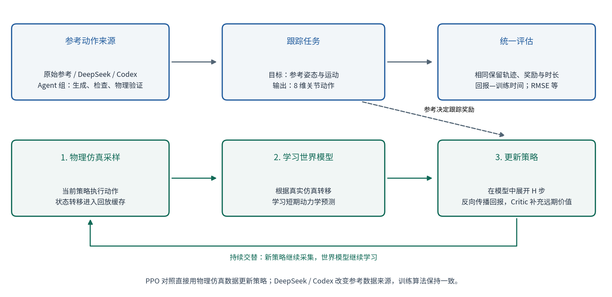
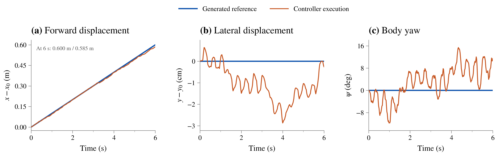
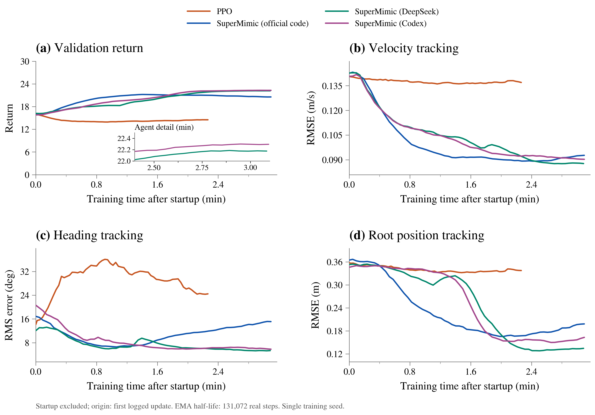
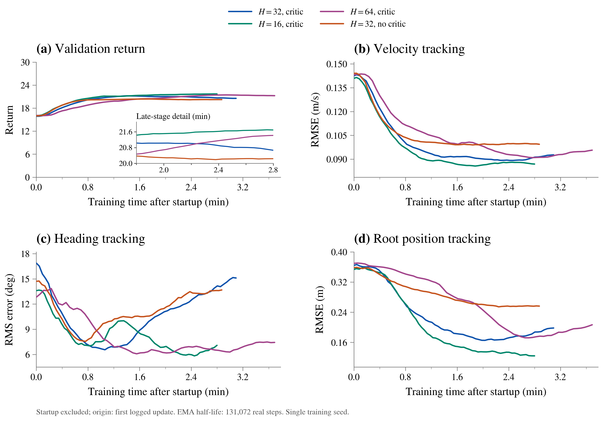
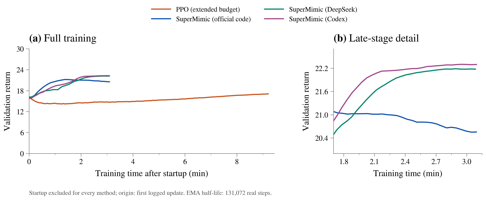

## 5. 基于世界模型的策略学习与参考轨迹对照

### 5.1 方法与实现

PPO 通过物理仿真采集状态转移，并利用这些样本更新策略。SuperMimic 交替执行仿真采样、世界模型学习和策略优化：世界模型预测状态变化，策略通过短期想象轨迹的时间反向传播优化回报，Critic 估计想象窗口之后的价值。世界模型在单次策略更新期间保持冻结，在模型学习阶段继续更新。可微世界模型复用不同参考动作共享的状态转移规律，为策略优化提供物理仿真之外的训练信号。[SuperMimic 项目说明](https://supermimic.github.io/)

SuperMimic 论文分别考察 PPO-Sim、PPO-WM 和直接优化想象回报的 SuperMimic。PPO-Sim 在物理仿真中采样，PPO-WM 在学习得到的世界模型中采样，两者均采用 PPO 更新；SuperMimic 则对想象回报直接求梯度。原论文超过 1000 倍的 GPU 小时差距来自与 SONIC 的比较，PPO-WM 对照衡量达到目标训练回报所需的想象步数。本文采用物理仿真中的 PPO 作为基线，并独立测量 Sesame 任务中的训练时间与策略表现。[SuperMimic 论文，第 4.1–4.2 节](https://arxiv.org/pdf/2610.28480)

PPO 对照与 SuperMimic 使用相同的 Actor/Critic 结构，采样过程完全在物理仿真中进行，对应 PPO-Sim。各组采用固定超参数，PPO-WM 不作为本文的实验对照。

图 5：参考生成与世界模型策略学习流程。参考轨迹定义跟踪目标；策略在物理仿真中采集状态转移以训练世界模型，并通过想象轨迹优化跟踪回报。

### 5.2 参考轨迹来源与对照组

| 方法 | 策略训练方法 | 训练参考来源 | 对照目的 |
|---|---|---|---|
| PPO | 物理仿真中的 PPO | 原始参考 | 无世界模型的基线 |
| SuperMimic（官方代码） | 官方 SuperMimic 的 Sesame 适配 | 与 PPO 相同的原始参考 | 更换策略训练方法的影响 |
| SuperMimic（DeepSeek） | 同一 SuperMimic 实现 | `deepseek-flash` 生成程序，经检查和仿真验证后的参考 | DeepSeek 数据生成流程与训练组合的效果 |
| SuperMimic（Codex） | 同一 SuperMimic 实现 | Codex 生成程序，经检查和仿真验证后的参考 | Codex 数据生成流程与训练组合的效果 |

原始参考由 Isaac 教师策略采集；DeepSeek 与 Codex 参考由 mjlab / MuJoCo 中的控制器执行获得。两种 Agent 均结合解析反馈控制、物理检查和机器人先验生成轨迹程序；Codex 程序采用迭代调试得到的控制结构，DeepSeek 提示包含可执行范例。参考来源同时改变动作分布及其与训练仿真动力学的一致性。因此，Agent 对照评价参考生成与策略训练的整体效果，语言模型能力不是单独控制的实验变量。

Agent 生成的参考轨迹作为策略的跟踪目标，推理阶段由训练后的策略输出 8 维动作。世界模型的训练数据来自策略在线采集的状态转移；32 条参考轨迹决定目标动作集合，世界模型的转移样本量由仿真交互预算决定。

参考生成采用 MimicAgent 的“动作规划 → 程序生成 → 执行检查 → 诊断修订”流程。原方法通过运动学检查筛选粗参考，再由强化学习获得动力学可行的执行。本文进一步对候选轨迹进行标称参数与域随机化条件下的物理仿真检验，并将通过检验的实际执行轨迹纳入参考集。MimicAgent 用于参考生成，SuperMimic 用于策略训练。[MimicAgent 论文，第 III 节](https://arxiv.org/html/2609.24145v1#S3)

以一条 Codex 生成轨迹为例，图 6 对比运动学参考与反馈控制器在标称参数下的物理仿真执行。两者具有相同初始位姿，参考沿世界 +X 方向以 0.10 m/s 前进。6 秒内参考与执行的前向位移分别为 0.6000 m 和 0.5845 m，执行平均前进速度为 0.0974 m/s；最大绝对横向位移为 2.87 cm，航向 RMS 为 6.42°。该片段展示参考采集阶段的跟踪情况，训练后策略的运动表现由第 5.5 节统一测试评价。

图 6：Codex 生成的参考轨迹与反馈控制加 PD 控制器的仿真执行对比。(a) 前向位移；(b) 横向位移；(c) 机身偏航角。横轴为仿真时间，蓝线表示运动学参考，橙线表示控制器执行；位移以初始位置为原点，方向沿世界坐标轴。连续实线连接 50 Hz 原始记录，包含初始状态和 300 个控制步后的状态，未作平滑。该片段为参考采集中的单条标称参数检验示例，入库数据采用通过检验的实际执行轨迹。

### 5.3 实验设置与评价指标

四组采用相同的机器人、地形、跟踪奖励、0.5 ms 物理步长、50 Hz 控制频率、512 个并行环境、Actor/Critic 结构、域随机化配置及 2,097,152 个真实环境步预算。每组使用 24 条训练参考，每条持续 6 秒，参考来源为实验变量。原始参考截取前 6 秒；Codex 生成的 41 条合格记录按固定顺序选取前 32 条，再固定打乱并划分为 24/4/4 条训练、验证和测试轨迹；DeepSeek 的 32 条参考采用相同划分。共同验证集与测试集各包含原始、DeepSeek 和 Codex 三个来源的 4 条轨迹，共 12 条，各来源等权。测试轨迹与训练数据及生成提示隔离。

学习曲线纵轴为验证轨迹回报 `Return = Σr_t`，横轴为首次参数更新后的累计训练时间。各组在首次更新后立即评估，并以该评估时刻定义时间零点；后续评估位于每 32,768 个真实环境步的全局边界及训练预算终点。主实验每组包含 65 个训练后评估点，延长预算 PPO 包含 257 个点。时间横轴扣除首次更新前的启动阶段及验证、测试和保存耗时，保留评估之间的采样与参数更新时间。曲线采用在完整评估序列上计算的因果 EMA，平滑半衰期为 131072 个真实交互步。每次验证从参考轨迹第一帧开始，执行完整 6 秒；最终测试使用预算结束时的策略。6 秒正奖励上限为 30，归一化回报定义为 `Return/30`。

计算成本采用三种统计口径：训练时间包括仿真采样、模型与策略更新及首次编译；曲线时间在此基础上扣除首次更新之前的启动阶段；端到端运行时间进一步包括初始化、验证、测试和保存。参考数据准备成本单独统计。各组在同一 GPU 上串行执行。

本节误差均相对参考轨迹计算：平面速度 RMSE 为 `√mean_t((vx−vx_ref)²+(vy−vy_ref)²)`；偏航 RMS 为 `√mean_t(wrap(ψ−ψ_ref)²)`，单位为度；机身位置 RMSE 为 `√mean_t((x−x_ref)²+(y−y_ref)²+(z−z_ref)²)`。先计算每条测试轨迹的 RMSE，再对全部轨迹取平均。第 2 节采用固定前向速度指令 `vx−0.10` 和世界 +X 航向，本节采用时变参考轨迹，两类误差分别在各自任务内比较。

RMSE 使用提前终止前的有效状态计算，并与提前终止数共同报告。本节全部实验采用训练种子 42、固定超参数和指定训练预算，结果反映该配置下的策略差异；单个训练种子的回合统计不用于估计跨种子方差。

### 5.4 跟踪奖励与网络参数

跟踪奖励由机身位姿、非足端连杆运动与动作平滑项组成。各跟踪项采用 `w × exp(−误差平方/尺度²)`，连杆项在所选非足端连杆上取平均。单步奖励为总奖励率乘以 0.02 秒控制周期。本节四个主对照组与消融组共享该奖励；第 2 节的速度指令行走任务使用独立的奖励定义。

| 奖励项 | 权重 w | 尺度 | 作用 |
|---|---:|---:|---|
| 机身位置跟踪 | 0.5 | 0.3 m | 跟踪参考的整体位移 |
| 机身姿态跟踪 | 0.5 | 0.4 rad | 保持参考方向与姿态 |
| 非足端连杆位置 | 1.0 | 0.3 m | 学习身体与腿部协调 |
| 非足端连杆姿态 | 1.0 | 0.4 rad | 限制错误的肢体构型 |
| 非足端连杆线速度 | 1.0 | 1.0 m/s | 跟踪运动速度 |
| 非足端连杆角速度 | 1.0 | 3.14 rad/s | 跟踪转动速度 |
| 相邻动作差平方和 | −0.1 | — | 减少动作跳变 |

Actor 输入包括 30 维本体观测的 10 帧历史和 220 维参考目标，共 520 维，输出 8 维动作。默认想象长度 H=32；世界模型结构为 512×3，Actor 为 512/256/128，Critic 为 256/128。策略想象批量为 2048；世界模型批量为 512，每次更新使用 10 批数据和 8 步预测训练，replay ratio=16。所有组均采用 gamma=0.99，包括无 Critic 组。奖励不包含足端跟踪项和关节限位惩罚，物理仿真与想象轨迹采用一致的奖励定义。

PPO 每个环境采样 32 步，每次更新包含 5 个 epochs 和 4 个 minibatches，学习率为 0.001，clip=0.2，gamma=0.99，GAE λ=0.95，熵系数为 0.005，目标 KL=0.01。初始动作标准差固定为 0.1，所有超参数在对照实验中保持固定。

### 5.5 主对照结果

图 7：共同验证集上的回报与跟踪误差。各组从首次更新后的实测评估开始，每 32,768 个真实环境步评估一次；横轴排除启动及评估耗时。实线为半衰期 131072 步的因果 EMA，各组使用训练种子 42。蓝、橙、绿、紫分别区分官方代码 SuperMimic、PPO、DeepSeek 与 Codex；回报面板的小图放大两组 Agent 在 2.4–3.1 分钟的结果。误差面板按观测范围设置纵轴。

| 方法 | 测试 Return | 速度 RMSE（m/s） | 偏航 RMS（°） | 机身 RMSE（cm） |
| --- | ---: | ---: | ---: | ---: |
| PPO | 14.681 | 0.1395 | 20.20 | 35.74 |
| SuperMimic（官方代码） | 20.299 | 0.0959 | 15.88 | 21.67 |
| SuperMimic（DeepSeek） | 22.071 | 0.0936 | 5.13 | 18.20 |
| SuperMimic（Codex） | 22.353 | 0.0898 | 5.20 | 18.17 |

相同真实环境步预算下，SuperMimic（Codex）取得最高测试回报 22.353。采用相同原始参考的官方代码 SuperMimic 比 PPO 高 5.617，其包含启动开销的训练时间为 PPO 的 3.41 倍。固定交互预算下，世界模型方法以更高计算开销获得了更高回报。第 5.8 节进一步比较相近训练时间内的策略质量。两个 Agent 组同时改变训练参考分布，其表现反映数据来源与策略学习的共同作用。

各方法分别在与其训练参考来源相同的 4 条保留测试轨迹上评估。测试轨迹未参与训练，每项结果为对应 4 条轨迹的平均累计回报。

| 方法 | 测试参考来源 | 测试 Return |
| --- | --- | ---: |
| PPO | 原始参考 | 15.384 |
| SuperMimic（官方代码） | 原始参考 | 23.496 |
| SuperMimic（DeepSeek） | DeepSeek | 24.173 |
| SuperMimic（Codex） | Codex | 24.372 |

各行使用对应来源的测试参考，测试目标随参考来源变化。

**实际运动表现**

采用四组在 2,097,152 步预算结束时的策略，从配对的相同初始状态独立执行全部 12 条测试轨迹。运动测量与训练结束测试分批执行。完整片段的实际前进速度定义为世界 X 净位移除以 5.98 秒，提前终止片段使用有效时长；参考速度采用相同时间段。绝对横向位移为各片段最终世界 Y 位移绝对值的平均值。运动方向偏差为净位移方向相对世界 +X 的绝对夹角，与机身偏航角分别统计。

| 方法 | 实际前进速度（m/s） | 参考速度（m/s） | 绝对横向位移（cm） | 运动方向偏差（°） | 完整执行 |
| --- | ---: | ---: | ---: | ---: | ---: |
| PPO | 0.0064 | 0.1048 | 7.02 | 70.61 | 12/12 |
| SuperMimic（官方代码） | 0.0412 | 0.1048 | 8.22 | 26.49 | 12/12 |
| SuperMimic（DeepSeek） | 0.0563 | 0.1048 | 4.40 | 13.75 | 12/12 |
| SuperMimic（Codex） | 0.0507 | 0.1048 | 3.69 | 14.97 | 12/12 |

三组 SuperMimic 的实际前进速度为 0.041–0.056 m/s，均低于 0.105 m/s 的统一参考速度。两种 Agent 组相对官方代码组具有更高的前进速度、更小的横向位移和运动方向偏差，但仍存在前向速度跟踪不足。

完整执行数表示未触发任务提前终止条件的轨迹数量，不等同于满足速度与方向要求的成功率。接近静止时，净位移方向对微小漂移敏感，因此与实际速度共同解释；净位移小于 1 μm 时，方向不定义。

### 5.6 想象长度与 Critic 消融

图 8：想象长度与 Critic 的消融实验。各组使用原始参考、相同真实环境步预算、奖励和评估集，比较 H=16、32、64 及 H=32 无 Critic 配置。横轴为扣除启动及评估耗时的训练时间；实线为半衰期 131072 步的因果 EMA，评估间隔为 32,768 个真实环境步，训练种子为 42。回报面板的小图放大 1.8–2.8 分钟的结果，误差面板按观测范围设置纵轴。

| 方法 | 测试 Return | 速度 RMSE（m/s） | 偏航 RMS（°） | 机身 RMSE（cm） |
| --- | ---: | ---: | ---: | ---: |
| H=32，有 Critic | 20.299 | 0.0959 | 15.88 | 21.67 |
| H=16，有 Critic | 21.509 | 0.0855 | 8.04 | 13.34 |
| H=64，有 Critic | 20.888 | 0.0996 | 7.35 | 25.23 |
| H=32，无 Critic | 20.083 | 0.1012 | 13.87 | 28.20 |

H=16、有 Critic 配置取得最高测试回报 21.509，同时具有最低的速度和机身位置 RMSE。H=64 的偏航 RMS 最低。H=32 移除 Critic 后回报下降 0.215，速度与机身位置误差增加，偏航误差减小。不同想象长度改变想象步数和计算量；在所测参考、训练种子及真实步预算下，H=16 相较 H=32 和 H=64 同时取得更高回报和更低训练开销。

### 5.7 计算与数据准备成本

| 方法 | 训练（分钟） | 端到端运行（分钟） | 真实步数 | 想象步数 | 提前终止 | 采样显存峰值（GiB） |
| --- | ---: | ---: | ---: | ---: | ---: | ---: |
| PPO | 2.44 | 11.79 | 2097152 | 0 | 0/12 | 1.01 |
| SuperMimic（官方代码） | 8.32 | 18.17 | 2097152 | 53608448 | 0/12 | 3.20 |
| SuperMimic（DeepSeek） | 8.27 | 18.06 | 2097152 | 53608448 | 0/12 | 3.20 |
| SuperMimic（Codex） | 8.25 | 18.08 | 2097152 | 53608448 | 0/12 | 3.20 |
| H=16，有 Critic | 7.98 | 17.89 | 2097152 | 26804224 | 0/12 | 2.15 |
| H=64，有 Critic | 8.84 | 18.60 | 2097152 | 107216896 | 0/12 | 5.30 |
| H=32，无 Critic | 8.03 | 17.83 | 2097152 | 53608448 | 0/12 | 2.99 |

训练时间采用同步后的采样与更新计时，并包含启动阶段；端到端时间包括初始化、评估和保存。评估耗时计入端到端时间，学习曲线仅统计训练计算。提前终止按任务终止条件统计，包含跌倒之外的终止原因。显存峰值为进程离散监测样本中的最大值。

官方代码 SuperMimic 的启动阶段持续 313.8 秒，占含启动训练时间的 62.8%；首次有效更新之后的训练耗时为 185.7 秒。启动阶段包含首次编译、数据积累和参数更新，在该短预算任务中构成主要计算开销。7 次训练启动前 GPU 检查均未发现其他 CUDA 计算进程；该检查反映启动时刻的资源占用。

参考数据准备成本包括轨迹生成、修订、仿真执行和验收，与策略训练成本分别统计。

| 数据准备阶段 | 阶段性质 | 合格参考 | 生成/修订次数 | API 次数 |
|---|---|---:|---:|---:|
| DeepSeek 试采集 | 先导采集 | 3 | 3 | 6 |
| DeepSeek 探索采集（中止） | 中止探索 | 4 | 12 | 26 |
| DeepSeek 正式采集 | 参考采集 | 32 | 33 | 66 |
| Codex 参考采集 | 参考采集 | 32 | 45 | 0 |
| Codex 验收规则复核 | 既有轨迹检验 | 41 | 45 | 0 |

DeepSeek 正式采集耗时 10.11 分钟，包含先导采集与中止探索的总耗时为 13.72 分钟。中止探索发生于生成提示调整之前。耗时依据阶段累计计时或起止时间统计；缺少完整时间记录的阶段不纳入耗时估计。Codex 验收规则复核检验已采集轨迹，未执行新增轨迹采集。

上述计时不包含教师策略训练与控制器调试。Codex 采集程序未调用外部 API，表中 0 次仅对应采集程序的调用统计；程序生成阶段的模型交互与调试耗时未纳入计时。

### 5.8 延长 PPO 预算的训练时间对照

为比较相近训练时间内的策略质量，将 PPO 的真实环境步预算设为 8,388,608。除步数预算外，训练种子 42、参考数据、网络、超参数及评估间隔均与原预算 PPO 一致。

图 9：延长预算 PPO 与三组 SuperMimic 的验证回报。横轴为首次更新后的训练时间，排除启动及评估耗时；实线为半衰期 131072 步的因果 EMA，各组曲线终止于各自预算。评估间隔为 32,768 个真实环境步，训练种子为 42。表中时间对照采用包含启动开销的训练计时。左图展示完整训练过程，右图放大 1.7–3.15 分钟、回报 20.0–22.7 的区域，以区分三组 SuperMimic 的回报。

以三组 SuperMimic 的最大累计训练时间 8.32 分钟为共同窗口上限，选取各组在该窗口内最后一次实测验证结果。各组保留实际评估时刻，时间对照同时报告已使用的真实环境步数。

| 方法 | 实际评估时间（分钟） | 已用真实步数 | 验证 Return |
| --- | ---: | ---: | ---: |
| PPO（延长预算） | 8.31 | 7405568 | 16.690 |
| SuperMimic（官方代码） | 8.32 | 2097152 | 20.578 |
| SuperMimic（DeepSeek） | 8.27 | 2097152 | 22.158 |
| SuperMimic（Codex） | 8.25 | 2097152 | 22.319 |

在相同原始参考下，官方代码 SuperMimic 的验证回报比延长预算 PPO 高 3.887，两次评估时刻相差 0.8 秒，对应真实环境步数分别为 2,097,152 和 7,405,568。该配置下，SuperMimic 在相近累计训练时间内以更少的物理仿真交互获得更高回报。

按图中的首次更新后训练时间统计，在 0–3.10 分钟窗口内，官方代码 SuperMimic 与延长预算 PPO 的最后一次实测验证回报分别为 20.578 和 14.744，差值为 +5.833，两次评估时刻相差 1.1 秒。包含启动开销与排除启动开销的两种计时口径均显示，世界模型策略在对应时间窗口内取得更高回报。

延长预算 PPO 的完整训练时间为 9.39 分钟，端到端运行时间为 44.05 分钟，最终测试回报为 17.080。本节采用固定超参数和单个训练种子，密集评估用于刻画学习过程，方法差异的跨种子稳定性不在该实验的估计范围内。
